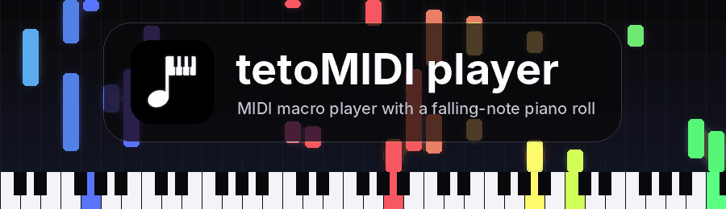

### 🎹 **MIDI macro player with a falling-note piano roll** 🎶

Load a `.mid` file and let tetoMIDI press the keyboard keys for you, while a falling-note roll shows what is being played.

## ⬇️ Download tetoMIDI v1.5.0

&nbsp;

📦 Looking for another version? See all [releases](https://github.com/XibeoFlower/teto-auto-player-app/releases).

| Platform | File | Notes |
|---|---|---|
| 🪟 **Windows** | `tetoMIDI-1.5.0-Setup.exe` | Run the installer. SmartScreen may show a warning because the file is unsigned. If your game runs as administrator, run tetoMIDI as administrator too. |
| 🐧 **Linux** | `tetoMIDI-1.5.0-Linux.zip` | Extract the zip and run the app. Needs an **X11** session (key injection and global hotkeys do not work on Wayland-only sessions). |

## 🎹 What is tetoMIDI?

tetoMIDI is a desktop app that reads a MIDI file and **presses the matching keys on your computer keyboard** — a piano macro player. It also draws a Synthesia-style piano roll so you can follow the song.

By default it makes no sound of its own: it only sends key presses. If you want to hear the song, turn on **🔊 Preview sound** (see below).

The interface uses a dark "liquid glass" design with rounded corners, a sliding sidebar and an intro animation.

## ✨ Features

- 🎼 **Piano, Drums and Guitar pages** — each with its own falling-note roll.
  - 🎹 Piano: 61 or 88 keys, Shift symbols, Ctrl layer, velocity, sustain.
  - 🥁 Drums: 21-hit map (Kick, Snare, Hi-hat, Open, Tom, Crash, Ride, Bell…).
  - 🎸 Guitar: six strings (E A D G B e) on the piano key layout.
- 🌈 **Falling-note piano roll**
  - **2D / 3D roll** switch (3D = perspective floor).
  - **Note colors**: Classic or Rainbow (Synthesia style).
  - **Key letters** printed on every piano key (keys played with Ctrl are blue).
  - 🖼️ **Custom background image** (JPG, PNG, GIF) with adjustable darkness.
- 🙌 **Hand mode** — play everything, only the left hand or only the right hand (split at C4).
- 📜 **MIDI Player window** — playlist (add files or a whole folder), PREV / PLAY / STOP / NEXT, seek bar, repeat (off / all / one), shuffle and speed. The playlist is saved between runs.
- 🪟 **Mini player** — a small always-on-top, title-bar-free window with transport buttons, song position and a **console** that lists the key presses being sent. Drag it from any empty spot.
- 🔊 **Preview sound** — play the song as a piano (SoundFont or built-in synth) instead of pressing keys.
- ⌨️ **Fake keyboard sound** — optional typing-click sound per key press, sent to an audio device of your choice.
- 🌐 **MIDI Hub** page.
- 🔥 **Global hotkeys**, rebindable in Settings.
- ⚙️ Settings for playback options, window opacity, always-on-top and reset.

## ⌨️ Hotkeys

| Action | Default key |
|---|---|
| ▶️ Play | `F2` |
| ⏸️ Pause | `F3` |
| ⏹️ Stop | `F4` |
| ⏩ Speed up | `F5` |
| ⏪ Slow down | `F6` |

All of them can be changed in **Settings**.

## 🛠️ Configuration

The config file is stored at:

- 🪟 Windows: `%APPDATA%\tetoMIDI\config.json`
- 🐧 Linux: `~/.config/tetoMIDI/config.json`

Set the `TETOMIDI_CONFIG_DIR` environment variable to use a different folder.

## 💬 Community

- 💜 Discord: **https://discord.gg/peaqm6uqgB**

## 📜 License

tetoMIDI is released under the **GNU GPL v3** (see [LICENSE](LICENSE)).

🎵 Happy playing! 🎵

